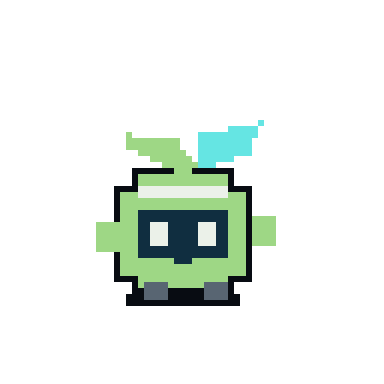

<!-- Root README of the standalone bergamot-3ds repository. Links are relative to that
     repository's root; tools/prepare_source_release.py copies this file to README.md
     when exporting the 3ds component. -->
<p align="center">
  
</p>

<h1 align="center">Bergamot 3DS</h1>

<p align="center">
  3DS emulation for Mac and iPhone, with no JIT. Built on <a href="https://github.com/azahar-emu/azahar">Azahar</a>.
</p>

<p align="center">
  <a href="https://github.com/sky-equals-fish/bergamot-3ds/releases/latest"><b>Download</b></a> ·
  <a href="docs/PLAYER.md">App guide</a> ·
  <a href="docs/THREEDS_SOURCE_PACKAGE.md">Use the core</a> ·
  <a href="docs/AZAHAR_PATCHES.md">Azahar patches</a>
</p>

---

Bergamot 3DS is part of [Project Bergamot](#about-project-bergamot) by Sky=Fish.
It's a small app you can download and play with, and the same emulator core
packaged so other apps can use it.

It runs entirely without JIT, on iPhone and on Mac. No special entitlements, no
debugger tricks, no AltServer step, and nothing a normal app isn't allowed to do.

## Download

Grab the latest build from [Releases](https://github.com/sky-equals-fish/bergamot-3ds/releases/latest).

**Mac** (Apple Silicon, macOS 13 or later)
1. Download the Mac `.zip` and unzip it.
2. The first time, open the app, then allow it under **System Settings ›
   Privacy & Security › Open Anyway**. Builds aren't notarized yet, so macOS
   asks once.
3. Open a game with **File › Open Game** or drag it onto the window.

**iPhone and iPad** (iOS 18 or later)
1. Download the Xcode project zip and open `Bergamot3DS.xcodeproj` in Xcode.
2. Under **Signing & Capabilities**, pick your team. A free Apple ID works, but
   those installs expire after 7 days.
3. Plug in your device and press **Run**. The emulator core is prebuilt, so
   there's nothing else to compile.

If you'd rather sideload, the unsigned `.ipa` works with AltStore or SideStore.
Import games from the app's library, or drop them into
**Files › On My iPhone › Bergamot 3DS › Games**.

Supported files: `.3ds`, `.cci`, `.cxi`, `.3dsx` and `.cia`. Encrypted games work
with your own `keys.txt`: **File › Install Keys…** on Mac, **Keys** on iPhone. Saves
are kept automatically.

### Settings

| Setting | Options |
| --- | --- |
| Upscaling | Auto (default on iPhone), 1× native (default on Mac), 2×, 3×, 4× |
| Screen layout | Stacked or side by side |
| Shaders | Prepare cached shaders (default), or also compile new ones in the background |
| GPU handoff | Standard (default) or queue-ordered (experimental) |

On Mac, open **Settings** with ⌘,. On iPhone, upscaling is on the library screen.
On iPhone, Auto picks the upscale from your model and screen: 3× on an iPhone 15 Pro.

Keyboard, game controllers, and the mouse (as the touch screen) all work. The
full control layout is in the [app guide](docs/PLAYER.md).

## Built on Azahar

The emulation itself is [Azahar](https://github.com/azahar-emu/azahar): the
ARM11 CPU, the 3DS operating system services, audio, and the graphics pipeline.
We couldn't have built this without it, and the credit for running your games
belongs to the people who work on it.

Our patches add the Mac/iOS-specific parts: frame handoff into Metal, a build
with every JIT removed, shader-cache preparation, a fix for half-second
freezes when games load code modules, and encrypted-game support, which Azahar
removed upstream. They're described in
[docs/AZAHAR_PATCHES.md](docs/AZAHAR_PATCHES.md), and most of them work on plain
Azahar too.

## Build from source

You'll need an Apple Silicon Mac, Xcode, Git and Python 3. Building for iPhone
also needs the iOS SDK that comes with Xcode.

```sh
git clone https://github.com/sky-equals-fish/bergamot-3ds.git
cd bergamot-3ds
python3 tools/bootstrap.py                  # fetches Azahar and applies our patches
export PATH="$PWD/.venv/bin:$PATH"
python tools/build_core.py macos            # the emulator core

cmake -S player -B build/player-macos -G Ninja -DCMAKE_BUILD_TYPE=Release -DCTR_PLATFORM=macos
cmake --build build/player-macos
open "build/player-macos/Bergamot 3DS.app"
```

iPhone builds, packaging, and signing are covered in [docs/PLAYER.md](docs/PLAYER.md).

## Use the core in your own app

The core is a C++20 / Objective-C++ library with a CMake target, so you can put
3DS emulation in your own Mac or iOS app without any of our UI.

```cmake
add_subdirectory(/path/to/bergamot-3ds/systems/3ds bergamot)
target_link_libraries(YourApp PRIVATE Bergamot::ThreeDS)       # the emulator
target_link_libraries(YourApp PRIVATE Bergamot::ThreeDSMetal)  # optional Metal presenter
```

```cpp
ctr::Runtime runtime(storage_root, /*vulkan=*/true, /*scale=*/1);
runtime.set_gpu_presenter([&](VkDevice device, VkImage image, unsigned w, unsigned h) {
    [presenter present:CTRExportTexture(device, image) on:metalLayer];
});
runtime.load(game_path);
runtime.wait_for_shader_cache();
while (!runtime.stopped()) runtime.step();   // pace to runtime.av_info().timing.fps
runtime.unload();
```

The [integration guide](docs/THREEDS_SOURCE_PACKAGE.md) covers threading,
audio, input, saves, and embedding the core in an iOS app.

## Technical notes

- **No JIT.** Guest code runs on Azahar's FastInterp interpreter. The JIT
  compilers aren't just switched off; they're removed from the build. A test hook
  fails the run if anything asks for executable memory.
- **Graphics.** Azahar renders with Vulkan, MoltenVK translates that to Metal,
  and the finished frame goes straight to the screen with no copy back to the CPU.
- **Frame pacing.** The game runs on its own 59.83 Hz clock, independent of the
  display. On a Mac this matters: a ProMotion screen idling at 48 Hz used to hold
  games at 80% speed.
- **Smoothness.** Shaders a game has used before are built before play starts,
  on parallel threads. A game's shader list can be exported from one device and
  imported on another, so a new iPhone starts with everything the Mac has seen.
  Code-module loads no longer freeze the game.

## Status

This is an early preview. On a Mac (M3 Pro), Pokémon Alpha Sapphire runs at
full speed, with no freezes over 100 ms after startup in our 3-minute test runs.
An earlier build of the core has run the same game on an iPhone 15 Pro, but
this app's iPhone build hasn't been tested on a device yet. Compatibility beyond the games we've tried is unknown.
What's been tested so far is in [docs/STATUS.md](docs/STATUS.md).

## About Project Bergamot

Project Bergamot is Sky=Fish's work on emulation for Apple devices without JIT.
It includes:

- **Bergamot**, a pixel-art emulator front end for iPhone and Mac. It hasn't been
  released yet. It supports 3DS, DS and GBA, with GameCube, Wii, Wii U, Switch,
  PS1, PS2, PSP and more in development.
- **Bergamot 3DS**, this repo: the 3DS core and a standalone app.

Bergie, the sprout at the top of this page, is the project's mascot.

## License

GPL-3.0-or-later, same as Azahar. See [LICENSE](LICENSE), [NOTICE.txt](NOTICE.txt)
and [THIRD_PARTY_NOTICES.txt](THIRD_PARTY_NOTICES.txt). MoltenVK is Apache-2.0.
Each release includes the full matching source, including the patched Azahar tree.

No games, keys or firmware are included. Nintendo 3DS is a trademark of
Nintendo; Bergamot isn't affiliated with Nintendo or the Azahar project.
